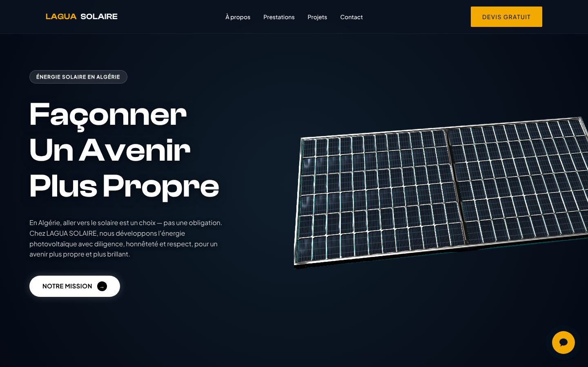

# LAGUA Solaire : page d'accueil 3D

Page d'accueil d'une entreprise d'énergie solaire en Algérie : panneau photovoltaïque en 3D (Three.js) dans l'en-tête, animations au défilement et widget d'assistant conversationnel.


**Démo en ligne :** [laguasolairef.vercel.app](https://laguasolairef.vercel.app)



## Fonctionnalités

- **Scène 3D** : modèle glTF d'un panneau bifacial chargé avec `GLTFLoader`, travelling de caméra au chargement, rotation automatique et inclinaison qui suit la souris (désactivée sur les écrans tactiles)
- **Animations au défilement** : apparition des sections avec `IntersectionObserver` et GSAP ScrollTrigger, compteurs animés (CountUp.js)
- **Assistant conversationnel** : fenêtre de chat en français avec indicateur de saisie et historique des 10 derniers échanges, envoyés à chaque requête vers l'endpoint `/api/chat`
- **Interface** : curseur personnalisé, barre de navigation qui réagit au défilement, menu mobile, mise en page responsive

> Ce dépôt contient la partie front-end. Le service qui répond sur `/api/chat` n'en fait pas partie : sans lui, le widget de chat affiche un message d'erreur.

## Stack technique

| Rôle | Outils |
|---|---|
| Structure et style | HTML, CSS sans framework, découpé en 4 feuilles (base, mise en page, composants, animations) |
| 3D | Three.js r128, GLTFLoader |
| Animation | GSAP 3 et ScrollTrigger, CountUp.js |
| Logique | JavaScript sans framework, un module par fonctionnalité |

## Lancer le projet

Le site est statique : il suffit de le servir depuis n'importe quel serveur web. Un serveur est nécessaire, car le modèle 3D ne se charge pas en ouvrant directement le fichier.

```bash
git clone https://github.com/medazero01-art/laguasolairef.git
cd laguasolairef
npx serve .        # ou : python -m http.server 8000
```

## Structure

```
├── index.html
├── assets/model.glb          # Modèle 3D du panneau
├── css/
│   ├── style.css             # Variables, typographie, base
│   ├── layout.css            # Sections et grilles
│   ├── components.css        # Boutons, cartes, chatbot
│   └── animations.css
└── js/
    ├── solar-panel-3d.js     # Scène Three.js
    ├── chatbot.js            # Interface du chat
    ├── cursor.js             # Curseur personnalisé
    └── main.js               # Navigation, révélations au scroll, compteurs
```

## Projet lié

[LaguaSolaire-Backend](https://github.com/medazero01-art/LaguaSolaire-Backend) : site complet de l'entreprise en Next.js (trilingue, formulaire de devis, gestion des prospects).

## Auteur

**Ayoub Touat** · [@medazero01-art](https://github.com/medazero01-art)
